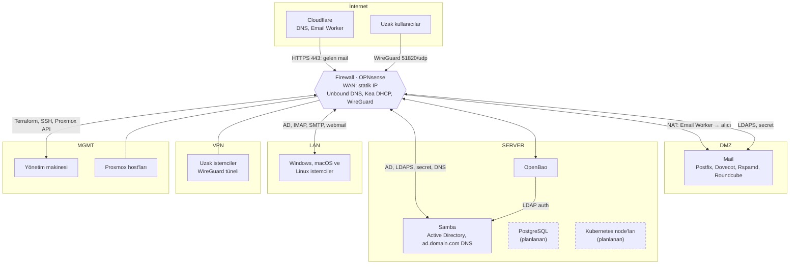

# Mimari

librenfra, bir kurumun ihtiyaç duyduğu IT altyapısını git'te tanımlanan, tekrar kullanılabilir bir template olarak sunar. Template'i kullanan kurum kendi domain'ini, IP planını ve hesaplarını veri dosyalarına yazar; server'lar, ağ kuralları ve DNS kayıtları bu tanımdan kurulur. Bu dokümanda örnek domain `domain.com`'dur.

Bu doküman template'in ağ topolojisini, bileşenlerini ve birbirleriyle bağlantısını anlatır. Değişikliklerin nasıl uygulandığı [CI/CD akışı](03-ci-cd.md) dokümanındadır.

## Ağ topolojisi

Firewall, ağı altı segmente ayırır ve segmentler arasındaki her bağlantı firewall üzerinden yönlendirilir. Grafikte bir segmentten diğerine giden her yol firewall'dan geçer; aynı segment içindeki trafik (örneğin Samba ile OpenBao arası) firewall'a uğramaz.

| Segment | İçindekiler | Açıklama |
| --- | --- | --- |
| WAN | Firewall'un dış arayüzü | Kurumun statik IP'si. Proxmox'ta WAN bridge'ine bağlı tek VM firewall'dur |
| DMZ | Mail | İnternetten trafik alan server'lar |
| SERVER | Samba, OpenBao; ileride PostgreSQL ve Kubernetes | İç servisler; internetten doğrudan erişilmez |
| LAN | Kurumun Windows, macOS ve Linux istemcileri | Domain'e katılan iş istasyonları |
| VPN | Uzaktan bağlanan istemciler | WireGuard firewall'da sonlanır; uzak istemci LAN'daki istemciyle aynı servislere erişir |
| MGMT | Proxmox host'ları, yönetim makinesi | Yalnız yönetim; Terraform buradan çalışır |

## Segmentler arası trafik

Firewall varsayılan olarak her şeyi reddeder; yalnız aşağıdaki akışlara izin verilir. Kuralların kaynağı `librenfra-firewall` reposundaki `config.yml`'dir ([Firewall](06-firewall.md)).

| Kaynak | Hedef | Port | Amaç |
| --- | --- | --- | --- |
| İnternet (yalnız Cloudflare IP aralıkları) | DMZ: Mail | 443/tcp, NAT | Email Worker'ın ilettiği gelen mail |
| İnternet | Firewall | 51820/udp | WireGuard VPN |
| DMZ: Mail | İnternet | 25/tcp, NAT | Giden mail, statik IP'den |
| SERVER: OpenBao | İnternet (Cloudflare R2) | 443/tcp, NAT | Gece raft snapshot'ı ([Secret'lar](05-secrets.md#openbao)) |
| DMZ: Mail | SERVER: Samba | 636/tcp | LDAPS: kullanıcı girişi, posta kutusu sorgusu |
| DMZ: Mail | SERVER: OpenBao | 8200/tcp | Secret'lar |
| LAN, VPN | SERVER: Samba | 53, 88, 135, 389, 445, 464, 636, 3268, 49152-65535 | Domain'e katılma ve giriş |
| LAN, VPN | DMZ: Mail | 443, 587, 993/tcp | Webmail, SMTP gönderimi, IMAP |
| LAN, VPN | Firewall | 53/udp+tcp | DNS (Unbound) |
| Firewall | SERVER: Samba | 53/udp+tcp | `ad.domain.com` sorgularının yönlendirilmesi |
| MGMT: Yönetim makinesi | Tüm segmentler | 22, 443, 8006, 8200/tcp | SSH, OPNsense ve Proxmox API'leri, OpenBao |

## Bileşenler

- **Firewall:** OPNsense. Segmentleri birbirinden ayırır, internete statik IP ile çıkar, DNS (Unbound), DHCP (Kea) ve VPN (WireGuard) hizmeti verir. `ad.domain.com` sorgularını Samba'ya yönlendirir. Proxmox'ta bir VM'dir; diğer server'lardan farkı, içinin NixOS değil OPNsense konfigürasyonu olmasıdır.
- **Cloudflare:** `domain.com`'un genel DNS'ini tutar. Gelen mail Cloudflare Email Worker ile karşılanır ve HTTPS ile firewall üzerinden Mail'deki alıcıya iletilir.
- **Mail:** DMZ'de durur. Kullanıcıları Samba'ya LDAPS ile doğrular, giden maili statik IP üzerinden gönderir.
- **Samba:** Active Directory domain controller'ı ([karar 0002](kararlar/0002-active-directory-secimi.md)). Kullanıcı, grup ve servis hesaplarını tutar, `ad.domain.com` alanının DNS'ini sunar. LAN ve VPN'deki istemciler domain'e katılır.
- **OpenBao:** Tüm secret'ları tutar. Server'lar kendi secret'larını OpenBao ajanıyla alır; insanlar Samba hesaplarıyla giriş yapar.
- **PostgreSQL ve Kubernetes node'ları:** Template'e sonradan eklenecek server'lardır. SERVER segmentinde, aynı kalıpla kendi repolarında tanımlanır.
- **Yönetim makinesi:** Terraform'un çalıştığı makine; MGMT segmentindedir ve template'in parçası değildir ([CI/CD akışı](03-ci-cd.md)).

## Kararlar

- **Her server bir repo:** Her server kendi reposunda tanımlanır ve kendi Terraform state'ine sahiptir (1 repo = 1 state).
- **Server'ların içi NixOS:** Firewall dışındaki tüm server'lar NixOS'tur; paketler, konfigürasyon ve servisler reponun flake'inden üretilir ([karar 0001](kararlar/0001-isletim-sistemi-secimi.md)). Çalışan server'da paket kurulmaz, dosya elle düzenlenmez.
- **Her şeyi Terraform uygular:** VM'ler, diskler, DNS kayıtları, firewall kuralları, dizin hesapları, OpenBao policy'leri ve NixOS kurulumu ile güncellemesi Terraform kaynaklarıdır. Ayrı bir runner veya reconciler yoktur.
- **Dizin servisi Samba AD** ([karar 0002](kararlar/0002-active-directory-secimi.md)).
- **Secret'lar OpenBao'da:** Hiçbir repoda ve hiçbir Nix ifadesinde secret yoktur ([Secret'lar](05-secrets.md)).
- **Güncellemede kesinti kabul:** İlk aşamada server güncellemelerindeki kesinti kabul edilir.

## Server tanımı

Her server reposu üç parçadan oluşur:

- **NixOS tanımı:** `flake.nix` ve `modules/`. `librenfra-terraform`'un flake'inden gelen ortak taban modülü (seri konsol, sshd, OpenBao ajanı, izleme ajanı, `users.mutableUsers = false`) ve `nixpkgs` sürümü burada girdi olarak alınır.
- **Veri:** `vm.yml`, `dns.yml`, `accounts.yml` gibi dosyalar. Server'ı değiştirmek için çoğu zaman yalnız bunlar düzenlenir.
- **Kök modül:** `main.tf`. State'in yerini belirler ve `librenfra-terraform`'daki Terraform modüllerini, sabit bir `librenfra-terraform` sürümüyle, veri dosyalarını okuyarak çağırır.

| Konu | Nasıl |
| --- | --- |
| VM ve diskler | `librenfra-terraform`'daki `proxmox-vm` modülü (bpg/proxmox provider) |
| NixOS kurulumu | `librenfra-terraform`'daki `nixos-server` modülü; nixos-anywhere ile VM'e NixOS'u kurar |
| NixOS güncellemesi | Aynı modül; sistemi yönetim makinesinde build edip `nixos-rebuild switch` ile server'a geçirir |
| Sürüm sabitleme | `flake.lock` (NixOS tarafı) ve `main.tf`'teki `librenfra-terraform` sürümü (Terraform tarafı) |
| Server'ın sürüm kimliği | Sistemin Nix store yolu; Terraform state'inde tutulur |
| Uygulamadan önce fark | `terraform plan`; NixOS tarafında store yolu değişir, paket farkı `nix store diff-closures` ile görülür |
| Geri dönüş | `git revert` + `terraform apply` veya server'da önceki generation |

## Versiyonlama

"`main` neyse server odur": `main`'e giren her commit server'ın yeni bir sürümünü tanımlar ve `terraform apply` ile uygulanır.

- **Sürüm tag'i:** Server reposunda `v1.2.3` git tag'i atılır.
- **`librenfra-terraform` sürümü:** Ortak taban, `nixpkgs` sürümü ve Terraform modülleri birlikte `librenfra-terraform`'un `v1.4.0` gibi sürümüyle anılır. Server reposu bu sürümü `main.tf`'teki modül kaynağında ve `flake.nix`'teki `librenfra-terraform` girdisinde belirtir.
- **Güvenlik güncellemeleri:** Renovate `librenfra-terraform`'da `nixpkgs` girdisini haftalık yükselten PR açar. `librenfra-terraform`'un yeni sürümü server repolarına yine Renovate PR'ı olarak gelir.
- **NixOS sürüm yükseltmesi:** Yılda iki kez `librenfra-terraform`'da `nixpkgs` dalını değiştiren planlı bir PR'dır.

## Server'lar

| Server | Repo | Segment | Veri dosyaları |
| --- | --- | --- | --- |
| Firewall | `librenfra-firewall` | WAN ve tüm segmentler | `vm.yml`, `config.yml` |
| OpenBao | `librenfra-secrets` | SERVER | `vm.yml`, `policies/` |
| Samba | `librenfra-active-directory` | SERVER | `vm.yml`, `accounts.yml` |
| Mail | `librenfra-mail` | DMZ | `vm.yml`, `dns.yml` |
| PostgreSQL (planlanan) | `librenfra-database` | SERVER | `vm.yml`, `databases.yml` |
| Kubernetes node'ları (planlanan) | `librenfra-cluster` | SERVER | `vm.yml` |

`librenfra-terraform` bir server değildir; tüm server'ların kullandığı Terraform modüllerini ve NixOS ortak taban modülünü taşır.

## Kaynaklar

- [NixOS kılavuzu](https://nixos.org/manual/nixos/stable/)
- [nixos-anywhere](https://github.com/nix-community/nixos-anywhere)
- [Samba wiki: AD domain controller](https://wiki.samba.org/index.php/Setting_up_Samba_as_an_Active_Directory_Domain_Controller)
- [bpg/terraform-provider-proxmox](https://github.com/bpg/terraform-provider-proxmox)
- [browningluke/terraform-provider-opnsense](https://github.com/browningluke/terraform-provider-opnsense)
