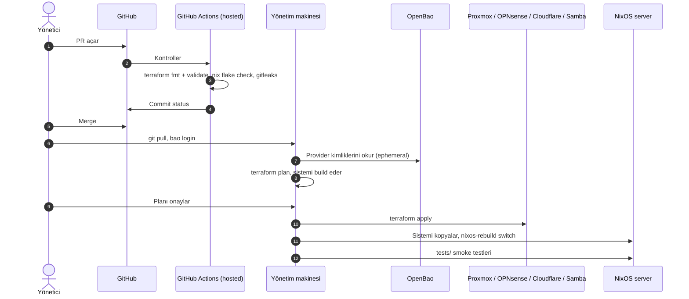

# CI/CD akışı

librenfra'da değişiklikler yönetim makinesinde yönetici tarafından Terraform ile manuel uygulanır.

## Bir değişikliğin yolculuğu

## CI: PR kontrolleri

Her server reposunda tek bir workflow dosyası vardır ve şunları çalıştırır:

- `terraform fmt -check` ve `terraform validate`: bu komutlar `librenfra-terraform` reposunun `modules` dizinindeki validasyonları çalıştırır.
- `nix flake check`: NixOS validasyonlarını çalıştırır.
- `gitleaks`: secret leaklerini tespit eder.

`librenfra-terraform` reposu template'in parçası olarak public'tir; CI flake girdisini kimliksiz çeker. Bu kontroller hiçbir kimlik kullanmaz ve iç ağa erişmez. Bu yüzden GitHub'ın hosted runner'ları yeterlidir; ayrı bir runner VM'i gerekmez. `terraform plan` ise iç API'lere eriştiği için CI'da değil, yönetim makinesinde çalışır.

## CD: terraform apply

Değişikliği yönetim makinesindeki yönetici uygular:

1. `main`'i çeker ve `bao login` ile OpenBao'ya kendi Samba hesabıyla girer.
2. Server reposunda `terraform plan` çalıştırır. Terraform provider kimliklerini (Proxmox, OPNsense, Cloudflare, Samba) OpenBao'dan ephemeral olarak okur; NixOS tarafında sistemi build eder ve store yolunun değişip değişmediğini gösterir.
3. Planı inceler ve `terraform apply` çalıştırır. VM, DNS, firewall ve hesap değişiklikleri uygulanır; store yolu değiştiyse sistem server'a kopyalanır ve `nixos-rebuild switch` ile geçilir. Yalnız değişen servisler yeniden başlar.
4. Reponun `tests/` dizinindeki smoke testleri çalıştırır.

**Yönetim makinesi:** Terraform, Nix ve bao CLI kurulu, iç ağa erişimi olan bir makinedir. Bu template'in parçası değildir; kurum kendi yönetim makinesini kullanır. Firewall'da yönetim erişimi olan alias'a eklenir.

## Geri dönüş

- **Normal yol:** `git revert` + `terraform apply`. Önceki NixOS sistemi yönetim makinesinin Nix store'unda durduğu için yeniden build edilmez.
- **Acil yol:** Server'da `nixos-rebuild switch --rollback` veya boot menüsünden önceki generation. Sonrasında repo da geri alınır, yoksa bir sonraki `apply` yeni sistemi tekrar kurar.

## Drift

- **Server'ın dışı:** `terraform plan` VM, DNS, firewall kuralı ve hesap farklarını gösterir.
- **Server'ın içi:** `nixos-server` modülündeki `check` bloğu server'ın çalıştırdığı sistemin store yolunu state'teki ile karşılaştırır; fark `terraform plan` çıktısında uyarı olarak görünür.
- **Ne zaman:** Yönetici her değişiklikten önce zaten `plan` çalıştırır. Ayrıca düzenli aralıklarla (örneğin haftalık) tüm repolarda `plan` çalıştırılması önerilir.

## Ayrı bir runner olmamasının bedeli

| Bir runner'ın yapacağı | Bu yapıda |
| --- | --- |
| PR'da otomatik `terraform plan` yorumu | Plan yönetim makinesinde görülür; istenirse PR'a elle eklenir |
| Merge sonrası otomatik apply | Apply yöneticinin elindedir |
| Gece otomatik drift kontrolü | Düzenli `terraform plan` yöneticinin rutinidir |
| Smoke test başarısızsa otomatik geri dönüş | Geri dönüş elle yapılır |

Karşılığında hiçbir iç API (Proxmox, OPNsense, OpenBao, Samba) ve hiçbir server SSH'ı internete açılmaz, GitHub'da tek bir kimlik bulunmaz ve bakımı gereken ek bir servis yoktur. Otomasyon ileride gerekirse, iç ağa VPN ile bağlanan bir CI işi aynı `terraform apply`'ı çalıştırabilir; Terraform kodu değişmez.

## Elle müdahale

- **Server açılmıyorsa:** Proxmox konsolundan boot menüsündeki önceki generation seçilir.
- **Firewall çöktüğünde:** Çalışan server'lar etkilenmez; yalnız yeni değişiklik uygulanamaz.
- **OpenBao kapalıysa:** Terraform provider kimliklerini okuyamaz. OpenBao unseal edilene kadar değişiklik uygulanamaz ([Secret'lar](05-secrets.md#unseal-ve-kurtarma)).
