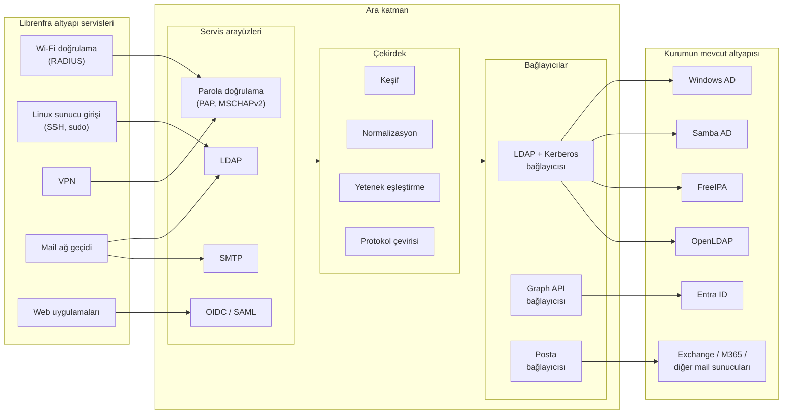
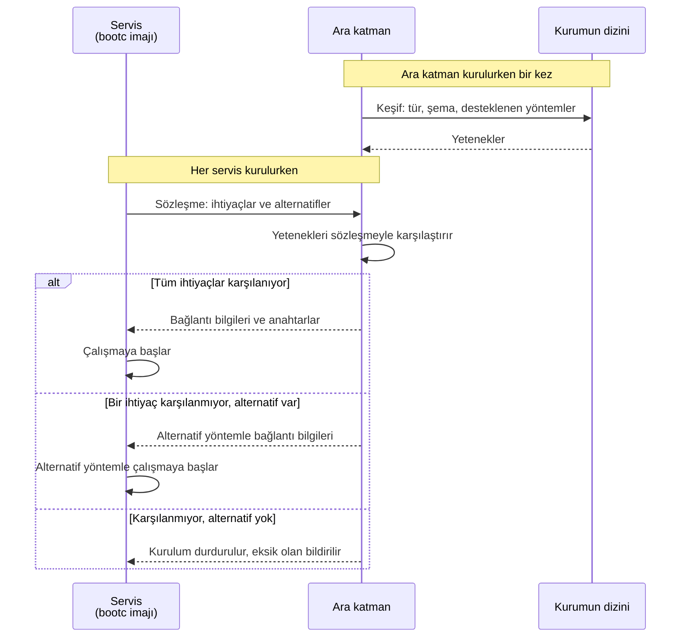
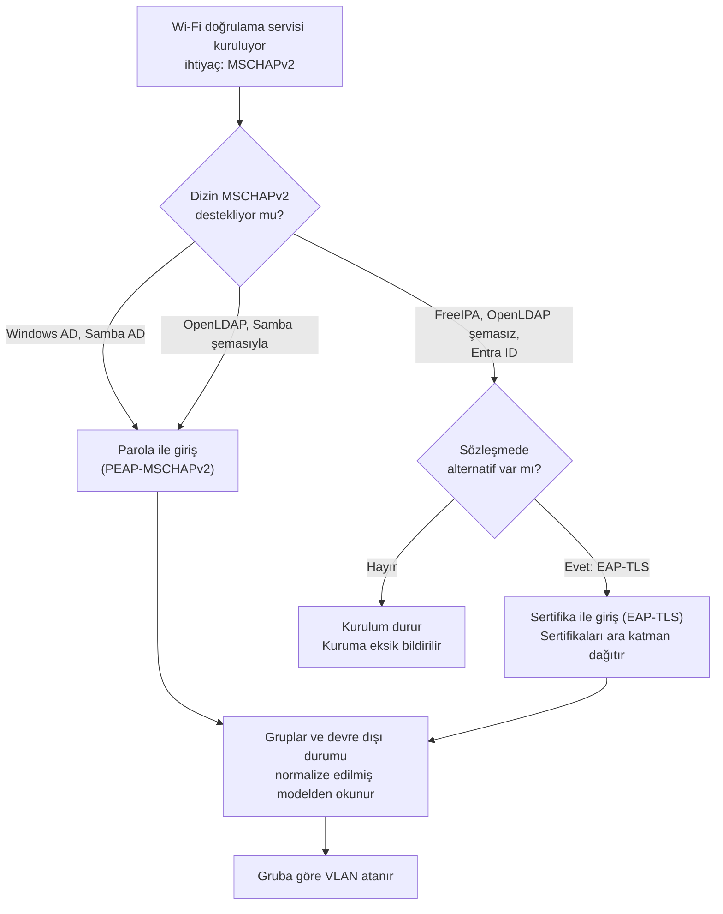

# Entegrasyon

Projenin amacı kurumların açık kaynak altyapılara geçişi kolaylaştıran bir taban sağlamaktı. Entegrasyonun kolay ve zahmetsiz olması için Librenfra tabanında geliştirdiğimiz servislerin, kurumların kullanabileceği her türlü altyapıya uyumlu olması gerekiyor.

## Sorun: aynı servis, farklı dizinler

Librenfra'nın kurduğu açık kaynak altyapı servisleri kullanıcıları kurumun dizinine sorarak doğrular. Ancak kurumların dizinleri aynı değildir: Windows Active Directory, Samba AD, FreeIPA, OpenLDAP ya da yalnızca Entra ID. Bu dizinler aynı soruya aynı şekilde cevap vermez, bazı sorulara hiç cevap veremez.

Kablosuz ağ (Wi-Fi, eduroam) için kullanıcı doğrulayan bir RADIUS servisi bunu iyi gösterir. Bu servisin dizinden üç şey istemesi gerekir: parolayı MSCHAPv2 ile doğrulamak, VLAN ataması için kullanıcının gruplarını öğrenmek ve hesabın devre dışı olup olmadığını kontrol etmek.

| Dizin | MSCHAPv2 ile parola doğrulama |
| --- | --- |
| Windows AD | Çalışır (NTLM üzerinden) |
| Samba AD | Çalışır (aynı yöntemle) |
| FreeIPA | Varsayılan olarak çalışmaz, NT hash'ini saklamıyor |
| OpenLDAP | Yalnızca şemada Samba parola alanı varsa çalışır |
| Yalnızca Entra ID | Çalışmaz; Entra ID LDAP, Kerberos ve NTLM sunmuyor |

Parola doğrulandıktan sonra da sorun bitmez, çünkü aynı bilgi her dizinde farklı yerde durur:

| Bilgi | Windows AD / Samba AD | FreeIPA | OpenLDAP |
| --- | --- | --- | --- |
| Giriş adı | `sAMAccountName`, `userPrincipalName` | `uid` | `uid` |
| Grup üyeliği | `memberOf`, iç içe gruplarla | `memberOf` | Yapılandırmaya göre `memberOf`, `member` ya da `memberUid` |
| Hesap devre dışı mı | `userAccountControl` alanındaki bir bit | `nsAccountLock` | Parola politikası eklentisine göre değişir |

Bir hesabın devre dışı olduğunu yanlış okumak, işten ayrılmış birinin ağa bağlanmaya devam etmesi demektir. Her servisin bu farkları kendi başına çözmesi hem tekrar hem de güvenlik riskidir. Bu farkların tek bir yerde, doğru bir şekilde çözülmesi gerekir. O yer ara katmandır.

## Ara katman nedir

Ara katman, Librenfra servisleri ile kurumun mevcut dizin ve mail altyapısı arasında duran ve iki tarafı birbirine uyduran servistir. Servisler her kurumda aynı arayüzü görür. Kurumlar arasındaki fark yalnızca ara katmanın arkasında kalır. Üç parçadan oluşur:

- **Servis arayüzleri:** Servislerin konuştuğu standart protokoller: LDAP, parola doğrulama (PAP, MSCHAPv2), OIDC/SAML ve SMTP.
- **Çekirdek:** Kurumlar arasındaki farkları çözen dört görev: keşif, normalizasyon, yetenek eşleştirme ve protokol çevirisi. Librenfra'nın asıl yazacağı yazılım budur.
- **Bağlayıcılar:** Kurumun dizinine ve mail sunucusuna kendi dilinde konuşan parçalar. LDAP ve Kerberos konuşan dizinler (Windows AD, Samba AD, FreeIPA, OpenLDAP) tek bir bağlayıcıyı paylaşır. Entra ID ise Graph API üzerinden ayrı bir bağlayıcı ister.



Bu yapıda servisler kurumun hangi dizini kullandığını bilmez. Kurum Windows AD'den Samba AD'ye geçtiğinde servislerin hiçbiri yeniden yapılandırılmaz; değişen tek şey ara katmanın bağlandığı adrestir.

## Ara katmanın görevleri

### 1. Keşif

Ara katman bağlandığı dizinin türünü ve neleri desteklediğini kendisi anlar. LDAP konuşan dizinlerde bunu dizinin kendini tanıttığı bilgilerden (rootDSE) ve şemasından çıkarır: hangi nesne sınıfları var, Linux kullanıcı numaraları tanımlanmış mı, NT hash'i saklanıyor mu, iç içe grup sorgusu destekleniyor mu. Kurum yalnızca dizinin adresini ve bir servis hesabını verir, ayrıntıları elle girmez.

### 2. Normalizasyon

Ara katman servislere her dizinde aynı görünen bir kullanıcı modeli sunar. Servis `sAMAccountName` ile `uid` arasındaki farkı ya da `userAccountControl` ile `nsAccountLock` arasındaki farkı bilmez.

```yaml
# Ara katmanın her dizinde servislere sunduğu kullanıcı
kullanici:
  giris_adi: ayse.yilmaz
  ad_soyad: Ayşe Yılmaz
  eposta: ayse.yilmaz@kurum.edu.tr
  devre_disi: false
  gruplar:            # iç içe gruplar çözülmüş olarak
    - personel
    - bilgi-islem
  linux:
    uid: 1104231
    gid: 1100513
```

### 3. Yetenek eşleştirme

Servis ihtiyacını bir **yetenek** olarak bildirir, örneğin "MSCHAPv2 ile parola doğrulama". Ara katman, keşifte öğrendiği bilgiye bakarak arkadaki dizinin bu yeteneği karşılayıp karşılayamadığını söyler. Karşılayamıyorsa servisin sözleşmesinde bildirdiği alternatife geçer ya da kuruma neyin eksik olduğunu açıkça bildirir. Servis kurulduktan sonra çalışmaması yerine, kurulumdan önce neden çalışmayacağı söylenir.

### 4. Protokol çevirisi

Servisin konuştuğu dili dizinin anladığı dile çevirir. Örneğin LDAP soran bir servisin arkasında Entra ID varsa, ara katman Graph API'den aldığı veriyi kendi LDAP arayüzünden sunar. Tersine, OIDC ile giriş isteyen bir web uygulamasının arkasında yalnızca LDAP bilen bir dizin varsa, giriş akışını ara katmanın kimlik sağlayıcısı yürütür.

### 5. Kimlik numarası eşleme

Linux tabanlı servisler her kullanıcı ve grup için sayısal bir numara (UID, GID) ister. FreeIPA ve OpenLDAP bu numaraları saklar. Windows AD'de ise çoğu zaman yoktur. Bu durumda ara katman numaraları kullanıcının Windows kimliğinden (SID) her seferinde aynı sonucu verecek şekilde üretir. Böylece iki farklı sunucu aynı kullanıcıya aynı numarayı verir ve dosya izinleri sunucular arasında tutarlı kalır.

## Yetenek matrisi

Yetenek matrisi, ara katmanın her dizin türünde neyi doğrudan kullanabildiğini ve neyi kendisi tamamlaması gerektiğini gösterir. Keşif adımı bu tabloyu her kurum için somut olarak doldurur.

| Yetenek | Windows AD | Samba AD | FreeIPA | OpenLDAP | Yalnızca Entra ID |
| --- | --- | --- | --- | --- | --- |
| LDAP ile kullanıcı ve grup okuma | Var | Var | Var | Var | Yok, Graph API ile |
| LDAP ile parola doğrulama (PAP) | Var | Var | Var | Var | Yok |
| Kerberos | Var | Var | Var | Ayrı bir Kerberos sunucusu varsa | Yok |
| NTLM / MSCHAPv2 | Var | Var | Varsayılan olarak yok | Samba şeması varsa | Yok |
| Linux kullanıcı numaraları (UID/GID) | Alanlar doldurulduysa | Alanlar doldurulduysa | Var | Genellikle var | Yok |
| İç içe gruplar | Var | Var | Var | Genellikle yok | Var |
| Değişiklikleri izleme | Var | Var | Var | Var | Var, Graph delta ile |
| Tarayıcıda giriş (OIDC/SAML) | Yok (AD FS ile var) | Yok | Yok | Yok | Var |
| Sunucunun domain'e katılması | Var | Var | Var, Linux için | Yok | Yok, Linux sunucular için |

Tablodaki her "yok" ya da "koşullu" hücre için ara katman şu dört yoldan birini seçer:

| Yol | Ne demek | Örnek |
| --- | --- | --- |
| Tamamlar | Eksik bilgiyi kendisi üretir | Windows AD'de olmayan Linux kullanıcı numaralarını SID'den üretir |
| Çevirir | Eksik protokolü kendi arayüzünden sunar | Entra ID'nin Graph verisini LDAP olarak sunar; LDAP dizinleri için OIDC girişini kendisi yürütür |
| Alternatife geçer | Servisin bildirdiği ikinci yöntemi kullanır | MSCHAPv2 olmayan dizinde Wi-Fi doğrulamasını sertifikayla (EAP-TLS) yapar |
| Bildirir | Karşılanamayan ihtiyacı kuruluma başlamadan söyler | Yalnızca Entra ID kullanan kurumda dosya sunucusunun katılabileceği bir domain olmadığını bildirir |

## Servis sözleşmesi ve kurum ayarı

Her Librenfra servisi ara katmandan neye ihtiyaç duyduğunu bir sözleşme dosyasında yetenekler halinde bildirir. Bir yetenek karşılanamazsa ne yapılacağı da sözleşmede yazar. Sözleşme servisin imajıyla gelir ve her kurumda aynıdır.

```yaml
# /usr/share/librenfra/services/wifi-dogrulama.yaml
service: wifi-dogrulama
version: 1.0.0

requires:
  - capability: password.mschapv2      # PEAP-MSCHAPv2 ile parola doğrulama
    fallback: certificate.eap-tls      # yoksa sertifikayla giriş
  - capability: user.groups            # VLAN ataması için
    nested: true
  - capability: user.disabled          # devre dışı hesapları reddetmek için
    fallback: none                     # alternatifi yok, karşılanmazsa kurulum durur
```

Kuruma özel bilgiler ise ayrı bir ayar dosyasındadır. Kurum yalnızca dizinin ve mail sunucusunun adresini ve erişim bilgisini verir; dizinin türünü ve yeteneklerini ara katman keşif adımında kendisi bulur.

```yaml
# /etc/librenfra/kurum.yaml
directory:
  url: ldaps://dc1.kurum.local          # Entra ID için: tenant kimliği
  service_account: svc-librenfra
mail:
  smarthost: mail.kurum.local:587
```

Bir servis kurulurken ara katman, servisin sözleşmesini keşifte öğrendiği yeteneklerle karşılaştırır:



Bu sözleşme Librenfra'nın servislerle olan asıl API'sidir. Bir topluluk üyesi yeni bir servis eklediğinde kurumların dizin farklılıklarını bilmek zorunda kalmaz; yalnızca ihtiyaç duyduğu yetenekleri ve alternatiflerini yazar.

## Örnek: Wi-Fi doğrulama servisi

X üniversitesinde yetkili ve BT alanında yetkin bir kişi, Librenfra'nın Wi-Fi doğrulama servisini kurmak istiyor. Ara katman üniversitede zaten kurulu ve keşif adımını tamamlamış. Kişinin yaptığı tek şey servisin imajını başlatmak. Bundan sonra olacaklar üniversitenin dizinine bağlıdır:



- **Windows AD veya Samba AD kullanan bir üniversitede** servis doğrudan çalışır. Kullanıcılar Wi-Fi'a mevcut kullanıcı adı ve parolalarıyla bağlanır.
- **FreeIPA ya da yalnızca Entra ID kullanan bir üniversitede** ara katman kurulumdan önce MSCHAPv2'nin mümkün olmadığını söyler ve sözleşmedeki alternatife geçer. Kullanıcılar parola yerine cihazlarına yüklenen bir sertifikayla bağlanır. Bu daha güvenli bir yöntemdir, ama cihazlara sertifika dağıtmayı gerektirir.
- **Her durumda** gruplar ve devre dışı durumu aynı normalize edilmiş modelden okunur. Bir personelin işten ayrıldığı an hangi dizinde olursa olsun Wi-Fi erişimi kapanır.

Servisin imajı, sürümü ve sözleşmesi bütün bu üniversitelerde aynıdır. Değişen tek şey, ara katmanın o kurumun dizinine göre verdiği karardır.

## Mail tarafı

Mail tarafında ara katmanın iki işi vardır: servislerin gönderdiği postayı kurumun mail servisine kabul ettirmek ve adres bilgisini normalize etmek.

**Posta iletimi.** Servisler bildirim postalarını ara katmanın SMTP arayüzüne gönderir. Her servisin kendi gönderim hesabı vardır ve yalnızca kendi adresinden posta gönderebilir. Ara katman postayı kurumun mail servisine iletir, mail servisine erişilemediğinde de kuyrukta bekletir.

| Mail servisi | Ara katman postayı nasıl iletir | Kurum tarafında yapılacak tek ayar |
| --- | --- | --- |
| Exchange Server | SMTP ile, IP adresi veya sertifikayla tanınır | Bir alma bağlayıcısı (receive connector) |
| Exchange Online (Microsoft 365) | SMTP ile, IP adresi veya sertifikayla tanınır | Bir gelen bağlayıcısı (inbound connector) |
| Diğer SMTP sunucuları | SMTP ile, kullanıcı adı ve parolayla | Bir gönderim hesabı |

**Adres normalizasyonu.** "Bu adres gerçekten var mı?" ya da "Bu adres kime ait?" soruları da dizine göre farklı cevaplanır. Bir mail ağ geçidi veya spam filtresi bu soruları her gelen posta için sorar.

| Dizin | Bir kullanıcının adresleri nerede durur |
| --- | --- |
| Windows AD (Exchange ile) | `proxyAddresses` alanında, `smtp:` önekiyle; birincil adres `SMTP:` büyük harfle |
| Samba AD, FreeIPA, OpenLDAP | Genellikle `mail` alanında |
| Yalnızca Entra ID | Graph API'de `proxyAddresses` ve `mail` alanlarında |

Ara katman bunları normalize edilmiş kullanıcı modelinde tek bir adres listesi olarak sunar.

## Sınırlar ve sıradaki deneyler

Wi-Fi örneği, dizine **soran** bir servisi anlatır. Bazı altyapı servisleri dizine yalnızca sormakla kalmaz, ondan daha fazlasını ister. Bu servisler ara katmanın yukarıda anlatılan görevlerinin ötesinde yeni görevler ortaya çıkarır ve katmanın sınırını belirler.

| Servis | Dizinden ne istiyor | Ortaya çıkardığı görev | Zorluk |
| --- | --- | --- | --- |
| Linux sunucu girişi (SSH, sudo) | Kullanıcı, grup, UID/GID, sudo kuralları | Kimlik numarası eşleme; sudo kurallarının Windows AD'de bir karşılığı yok | Düşük |
| Mail ağ geçidi | Alıcı adresinin var olup olmadığı | Adres normalizasyonu | Düşük |
| VPN | Doğrulama, grup bazında erişim, çok faktörlü doğrulama | Çok faktörlü doğrulamanın kimde yapılacağına karar verme | Orta |
| Dosya sunucusu | Domain'e katılma, Kerberos, Windows dosya izinleri | **Domain üyeliği:** servis dizine soran değil, dizine katılan bir bilgisayardır | Yüksek |
| DNS ve DHCP | DHCP'nin dağıttığı adresleri DNS'e güvenli kaydetmesi | **Yetki devri:** servis dizin adına yazma yetkisi ister | Yüksek |
| Sertifika otoritesi | Windows istemcilerin sertifikaları kendiliğinden alması | **İstemci uyumluluğu:** uyumlu olunması gereken şey dizin değil, Windows istemcinin kendisi | Çok yüksek |

Son iki satır ara katmanın sınırını gösterir. Uyumluluk yalnızca arkadaki dizinle değil, Windows istemcilerin beklentileriyle de ilgilidir. Bu boyutun Librenfra'nın kapsamına girip girmeyeceği ayrı bir karar konusudur.

Sıradaki düşünce deneyleri için önerilen sıra: Linux sunucu girişi (kimlik numarası eşlemeyi sınar), mail ağ geçidi (mail tarafını sınar), dosya sunucusu (domain üyeliğini sınar).

## Ne yazılacak, ne hazır alınacak

Ara katmanın servis arayüzleri olgun açık kaynak projelerle karşılanabilir. Librenfra'nın yazacağı şey, bu projelerin arkasındaki çekirdektir.

| Parça | Hazır alınabilecek aday | Librenfra'nın yazacağı |
| --- | --- | --- |
| OIDC / SAML kimlik sağlayıcı | Keycloak; alternatif olarak Authentik, Kanidm | Dizin türlerine göre hazır bağlantı profilleri |
| Parola doğrulama (RADIUS tarafı) | FreeRADIUS | Normalize edilmiş modelle entegrasyon |
| LDAP arayüzü | OpenLDAP veya 389 Directory Server | Normalize edilmiş modeli LDAP olarak sunan yapılandırma |
| Posta iletimi | Postfix | Servis başına hesap ve gönderen denetimi |
| Sertifika dağıtımı | step-ca | Kurumun CA'sına ara CA olarak bağlanma |
| Linux kimlik numarası eşleme | SSSD'nin mevcut eşleme algoritması | Tüm servislerde aynı algoritmanın kullanılması |
| Çekirdek | — | Tamamı: keşif, normalizasyon, yetenek eşleştirme, protokol çevirisi, servis sözleşmesi |

## Paketleme ve dağıtım

Ara katman ve her servis birer bootc imajı olarak dağıtılır. Servisin sözleşme dosyası imajın içindedir ve imajın sürümüne bağlıdır. Kuruma özel olan tek şey `kurum.yaml` dosyasıdır. Kurulum için hazır disk imajları (ISO, qcow2, vmdk) ya da otomasyon isteyen kurumlar için Terraform modülleri sunulur; sonraki güncelleme ve geri dönüş bootc'un işidir.

## Riskler

- **Ara katman tek hata noktası olur:** Ara katman çökerse tüm servislerde doğrulama durur, Wi-Fi'a ve VPN'e kimse bağlanamaz. En az iki örnekle çalışmalı ve kendi güncellemeleri servislerden daha dikkatli yönetilmelidir.
- **Keşif yanılabilir:** Bir dizinin yeteneklerini yanlış anlamak, özellikle devre dışı hesapları yanlış okumak, güvenlik açığı demektir. Her dizin türü için gerçek dizinlere karşı çalışan otomatik testler gerekir.
- **Normalizasyon bilgi kaybettirebilir:** Ortak model, bazı dizinlere özgü bilgileri taşıyamayabilir. Modelin dışında kalan bir bilgiye ihtiyaç duyan servis için kontrollü bir kaçış yolu gerekir.
- **Sözleşme erken donarsa:** Yetenek listesi ilk birkaç servise göre tasarlanıp değişmez hale gelirse sonraki servisleri karşılamayabilir. Sözleşme sürümlenmeli ve geriye dönük uyumlu değişmelidir.
- **Kapsamın büyümesi:** İstemci uyumluluğu (grup ilkeleri, Windows istemcilere otomatik sertifika) ara katmana eklenirse proje bir Windows sunucu taklidine dönüşebilir. Sınırın bilinçli çizilmesi gerekir.

## Açık sorular

- [ ] İlk sürümde hangi dizin türleri desteklenmeli? Windows AD ve Samba AD ile başlayıp FreeIPA, OpenLDAP ve Entra ID'yi sonraya bırakmak yeterli mi?
- [ ] Normalize edilmiş kullanıcı modelinde hangi alanlar olmalı?
- [ ] Yetenek listesi nasıl adlandırılmalı ve sürümlenmeli?
- [ ] Ara katmanın kimlik sağlayıcı parçası Keycloak mı olmalı, yoksa Authentik veya Kanidm de değerlendirilmeli mi?
- [ ] Çekirdek hangi dille yazılmalı?
- [ ] Dizine katılan servisler (dosya sunucusu) ve istemci uyumluluğu (sertifika, grup ilkeleri) ara katmanın kapsamında mı?
- [ ] Kurumun zaten bir SSO sistemi varsa (Shibboleth, CAS gibi) ara katman ona nasıl bağlanmalı?
