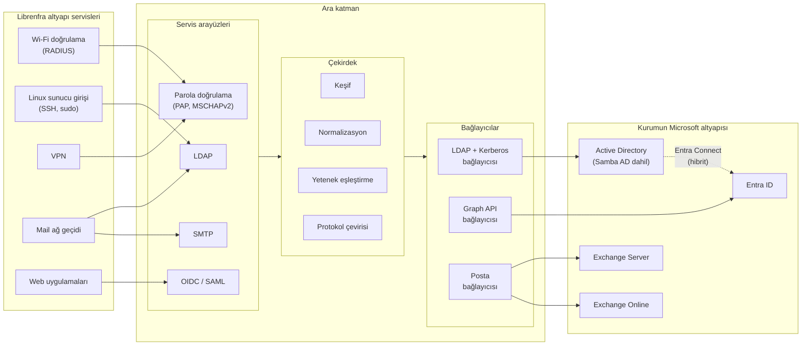
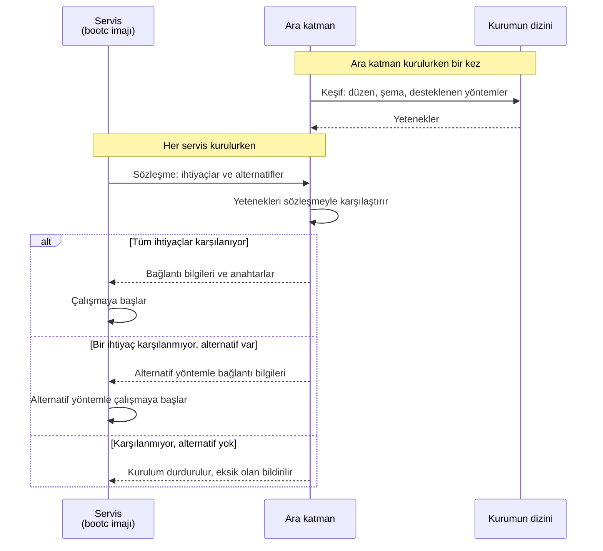
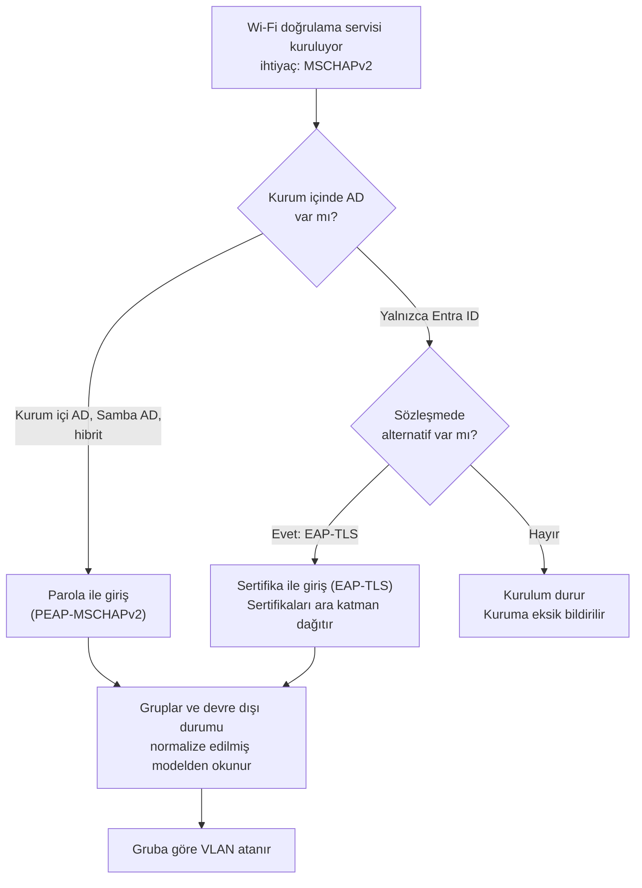

# Entegrasyon

Projenin amacı kurumların açık kaynak altyapılara geçişi kolaylaştıran bir taban sağlamaktı. Entegrasyonun kolay ve zahmetsiz olması için Librenfra tabanında geliştirdiğimiz servislerin, kurumların hâlihazırda kullandığı altyapıya uyumlu olması gerekiyor.

## Kapsam: Microsoft altyapısı

Üniversitelerde kimlik ve posta altyapısı neredeyse tamamen Microsoft ürünlerine dayanıyor. Bu yüzden Librenfra servislerinin ilk hedefi Microsoft altyapısıyla uyumlu çalışmaktır. Ancak "Microsoft altyapısı" tek bir şey değildir. Kurumlar üç farklı düzende çalışır:

| Düzen | Dizin | Posta | Servislerin dizine erişimi |
| --- | --- | --- | --- |
| Kurum içi | Active Directory | Exchange Server | LDAP, Kerberos, NTLM |
| Hibrit | Active Directory, Entra Connect ile Entra ID'ye senkronlanır | Çoğunlukla Exchange Online | Kurum içinde LDAP, Kerberos, NTLM; bulutta Graph API, OIDC, SAML |
| Yalnızca bulut | Entra ID | Exchange Online | Yalnızca Graph API, OIDC, SAML |

Hibrit düzen üniversitelerde en yaygın olanıdır: kullanıcılar kurum içindeki AD'de yönetilir, posta ve Microsoft 365 uygulamaları buluttadır. Ara katman bu üç düzenin hepsinde çalışmalıdır.

**Samba AD** Active Directory ile aynı protokolleri konuştuğu için kurum içi AD bağlayıcısıyla ek bir iş gerektirmeden çalışır. Bu, kurumların ileride Windows sunuculardan Samba AD'ye geçebilmesinin yolunu da açık tutar.

**Kapsam dışı:** FreeIPA, OpenLDAP ve Google Workspace gibi diğer dizin ve posta sistemleri şimdilik hedeflenmiyor. Bağlayıcılar ayrı parçalar olarak tasarlandığı için bunlar ileride çekirdeğe dokunmadan eklenebilir.

## Sorun: aynı servis, farklı Microsoft düzenleri

Librenfra'nın kurduğu açık kaynak altyapı servisleri kullanıcıları kurumun dizinine sorarak doğrular. Aynı Microsoft kurumunda bile bu sorunun cevabı düzene göre değişir.

Kablosuz ağ (Wi-Fi, eduroam) için kullanıcı doğrulayan bir RADIUS servisi bunu iyi gösterir. Bu servisin dizinden üç şey istemesi gerekir: parolayı MSCHAPv2 ile doğrulamak, VLAN ataması için kullanıcının gruplarını öğrenmek ve hesabın devre dışı olup olmadığını kontrol etmek.

| Düzen | MSCHAPv2 ile parola doğrulama |
| --- | --- |
| Kurum içi AD (Samba AD dahil) | Çalışır (NTLM üzerinden) |
| Hibrit | Çalışır, kurum içindeki AD üzerinden |
| Yalnızca Entra ID | Çalışmaz; Entra ID LDAP, Kerberos ve NTLM sunmuyor |

Parola doğrulandıktan sonra da sorun bitmez, çünkü aynı bilgi kurum içi AD'de ve Entra ID'de farklı yerde ve farklı biçimde durur:

| Bilgi | Kurum içi AD | Entra ID (Graph API) |
| --- | --- | --- |
| Giriş adı | `sAMAccountName`, `userPrincipalName` | `userPrincipalName` |
| Grup üyeliği | `memberOf`, iç içe gruplarla | `memberOf`, iç içe gruplar için `transitiveMemberOf` |
| Hesap devre dışı mı | `userAccountControl` alanındaki bir bit | `accountEnabled` |
| Kullanıcı kimliği | `objectSid`, `objectGUID` | `id`; senkronlanan kullanıcılarda ayrıca `onPremisesSecurityIdentifier` |

Hibrit düzende bir de zamanlama farkı vardır: AD'de devre dışı bırakılan bir hesap Entra ID'ye ancak bir sonraki senkronizasyonda yansır. Bir hesabın devre dışı olduğunu yanlış ya da geç okumak, işten ayrılmış birinin ağa bağlanmaya devam etmesi demektir. Her servisin bu farkları kendi başına çözmesi hem tekrar hem de güvenlik riskidir. Bu farkların tek bir yerde, doğru bir şekilde çözülmesi gerekir. O yer ara katmandır.

## Ara katman nedir

Ara katman, Librenfra servisleri ile kurumun mevcut Microsoft altyapısı arasında duran ve iki tarafı birbirine uyduran servistir. Servisler her kurumda aynı arayüzü görür. Kurumlar arasındaki fark yalnızca ara katmanın arkasında kalır. Üç parçadan oluşur:

- **Servis arayüzleri:** Servislerin konuştuğu standart protokoller: LDAP, parola doğrulama (PAP, MSCHAPv2), OIDC/SAML ve SMTP.
- **Çekirdek:** Düzenler arasındaki farkları çözen görevler: keşif, normalizasyon, yetenek eşleştirme, protokol çevirisi ve kimlik numarası eşleme. Librenfra'nın asıl yazacağı yazılım budur.
- **Bağlayıcılar:** Kurumun altyapısına kendi dilinde konuşan parçalar. Üç bağlayıcı vardır: kurum içi AD (ve Samba AD) için LDAP ve Kerberos bağlayıcısı, Entra ID için Graph API bağlayıcısı, Exchange Server ve Exchange Online için posta bağlayıcısı. Hibrit bir kurumda ilk iki bağlayıcı birlikte çalışır.



Bu yapıda servisler kurumun hangi düzende çalıştığını bilmez. Kurum posta sunucusunu Exchange Server'dan Exchange Online'a taşıdığında ya da dizinini Windows AD'den Samba AD'ye geçirdiğinde servislerin hiçbiri yeniden yapılandırılmaz; değişen tek şey ara katmanın bağlandığı adrestir.

## Ara katmanın görevleri

### 1. Keşif

Ara katman bağlandığı altyapının düzenini ve neleri desteklediğini kendisi anlar. Kurum içi AD'de bunu dizinin kendini tanıttığı bilgilerden (rootDSE) ve şemasından çıkarır: Linux kullanıcı numaraları tanımlanmış mı, Exchange şeması kurulu mu, iç içe grup sorgusu destekleniyor mu. Entra ID'de tenant bilgisinden ve kullanıcıların senkronize olup olmadığından (`onPremisesSyncEnabled`) düzenin hibrit mi yoksa yalnızca bulut mu olduğunu anlar. Kurum yalnızca adresleri ve servis hesaplarını verir, ayrıntıları elle girmez.

### 2. Normalizasyon

Ara katman servislere her düzende aynı görünen bir kullanıcı modeli sunar. Servis `userAccountControl` ile `accountEnabled` arasındaki farkı ya da kullanıcının AD'den mi Entra ID'den mi okunduğunu bilmez.

```yaml
# Ara katmanın her düzende servislere sunduğu kullanıcı
kullanici:
  giris_adi: ayse.yilmaz
  ad_soyad: Ayşe Yılmaz
  eposta: ayse.yilmaz@kurum.edu.tr
  devre_disi: false
  gruplar:            # iç içe gruplar çözülmüş olarak
    - personel
    - bilgi-islem
  linux:
    uid: 1104231
    gid: 1100513
```

Hibrit düzende aynı kullanıcı iki yerde bulunur. Ara katman ikisini kullanıcının Windows kimliği (SID) üzerinden eşler ve devre dışı durumu gibi güvenlik açısından kritik bilgileri senkronizasyonu beklemeden kurum içindeki AD'den okur.

### 3. Yetenek eşleştirme

Servis ihtiyacını bir **yetenek** olarak bildirir, örneğin "MSCHAPv2 ile parola doğrulama". Ara katman, keşifte öğrendiği bilgiye bakarak kurumun altyapısının bu yeteneği karşılayıp karşılayamadığını söyler. Karşılayamıyorsa servisin sözleşmesinde bildirdiği alternatife geçer ya da kuruma neyin eksik olduğunu açıkça bildirir. Servis kurulduktan sonra çalışmaması yerine, kurulumdan önce neden çalışmayacağı söylenir.

### 4. Protokol çevirisi

Servisin konuştuğu dili dizinin anladığı dile çevirir. Örneğin LDAP soran bir servisin arkasında yalnızca Entra ID varsa, ara katman Graph API'den aldığı veriyi kendi LDAP arayüzünden sunar. Tersine, OIDC ile giriş isteyen bir web uygulamasının arkasında yalnızca kurum içi AD varsa (AD FS kurulu değilse), giriş akışını ara katmanın kimlik sağlayıcısı yürütür.

### 5. Kimlik numarası eşleme

Linux tabanlı servisler her kullanıcı ve grup için sayısal bir numara (UID, GID) ister. Active Directory'de bu numaralar çoğu zaman tanımlı değildir, Entra ID'de ise hiç yoktur. Bu durumda ara katman numaraları kullanıcının Windows kimliğinden (SID) her seferinde aynı sonucu verecek şekilde üretir. Böylece iki farklı sunucu aynı kullanıcıya aynı numarayı verir ve dosya izinleri sunucular arasında tutarlı kalır. Hibrit düzende SID her iki tarafta da aynı olduğu için numara da aynı kalır.

## Yetenek matrisi

Yetenek matrisi, ara katmanın her düzende neyi doğrudan kullanabildiğini ve neyi kendisi tamamlaması gerektiğini gösterir. Keşif adımı bu tabloyu her kurum için somut olarak doldurur.

| Yetenek | Kurum içi AD (Samba AD dahil) | Hibrit | Yalnızca Entra ID |
| --- | --- | --- | --- |
| LDAP ile kullanıcı ve grup okuma | Var | Var, kurum içindeki AD'den | Yok, Graph API ile |
| LDAP ile parola doğrulama (PAP) | Var | Var, kurum içindeki AD'den | Yok |
| Kerberos | Var | Var, kurum içindeki AD'den | Yok |
| NTLM / MSCHAPv2 | Var | Var, kurum içindeki AD'den | Yok |
| Linux kullanıcı numaraları (UID/GID) | Alanlar doldurulduysa | Alanlar doldurulduysa | Yok |
| İç içe gruplar | Var | Var | Var |
| Değişiklikleri izleme | Var | Var | Var, Graph delta ile |
| Tarayıcıda giriş (OIDC/SAML) | Yok (AD FS ile var) | Var, Entra ID ile | Var |
| Çok faktörlü doğrulama | Yok | Var, Entra ID ile | Var |
| Sunucunun domain'e katılması | Var | Var | Yok, Linux sunucular için |

Tablodaki her "yok" ya da "koşullu" hücre için ara katman şu dört yoldan birini seçer:

| Yol | Ne demek | Örnek |
| --- | --- | --- |
| Tamamlar | Eksik bilgiyi kendisi üretir | AD'de ve Entra ID'de olmayan Linux kullanıcı numaralarını SID'den üretir |
| Çevirir | Eksik protokolü kendi arayüzünden sunar | Entra ID'nin Graph verisini LDAP olarak sunar; AD FS olmayan kurum içi AD için OIDC girişini kendisi yürütür |
| Alternatife geçer | Servisin bildirdiği ikinci yöntemi kullanır | Yalnızca Entra ID kullanan kurumda Wi-Fi doğrulamasını sertifikayla (EAP-TLS) yapar |
| Bildirir | Karşılanamayan ihtiyacı kuruluma başlamadan söyler | Yalnızca Entra ID kullanan kurumda dosya sunucusunun katılabileceği bir domain olmadığını bildirir |

Yalnızca Entra ID kullanan bir kurum LDAP, Kerberos ve NTLM'e ihtiyaç duyan servisler için Microsoft Entra Domain Services'i (ücretli, yönetilen bir domain) de açabilir. Bu durumda ara katman onu kurum içi AD gibi görür ve LDAP + Kerberos bağlayıcısıyla bağlanır.

## Servis sözleşmesi ve kurum ayarı

Her Librenfra servisi ara katmandan neye ihtiyaç duyduğunu bir sözleşme dosyasında yetenekler halinde bildirir. Bir yetenek karşılanamazsa ne yapılacağı da sözleşmede yazar. Sözleşme servisin imajıyla gelir ve her kurumda aynıdır.

```yaml
# /usr/share/librenfra/services/wifi-dogrulama.yaml
service: wifi-dogrulama
version: 1.0.0

requires:
  - capability: password.mschapv2      # PEAP-MSCHAPv2 ile parola doğrulama
    fallback: certificate.eap-tls      # yoksa sertifikayla giriş
  - capability: user.groups            # VLAN ataması için
    nested: true
  - capability: user.disabled          # devre dışı hesapları reddetmek için
    fallback: none                     # alternatifi yok, karşılanmazsa kurulum durur
```

Kuruma özel bilgiler ise ayrı bir ayar dosyasındadır. Kurum yalnızca kullandığı parçaların adresini ve erişim bilgisini verir; düzeni ve yetenekleri ara katman keşif adımında kendisi bulur. Hibrit bir kurum her iki bölümü de doldurur.

```yaml
# /etc/librenfra/kurum.yaml
directory:
  active_directory:                     # kurum içi AD veya Samba AD
    url: ldaps://dc1.kurum.local
    service_account: svc-librenfra
  entra_id:                             # hibrit veya yalnızca bulut
    tenant_id: 00000000-0000-0000-0000-000000000000
    client_id: 00000000-0000-0000-0000-000000000000
mail:
  smarthost: kurum-edu-tr.mail.protection.outlook.com:25   # Exchange Server için: mail.kurum.local:25
```

Bir servis kurulurken ara katman, servisin sözleşmesini keşifte öğrendiği yeteneklerle karşılaştırır:



Bu sözleşme Librenfra'nın servislerle olan asıl API'sidir. Bir topluluk üyesi yeni bir servis eklediğinde kurumların düzen farklılıklarını bilmek zorunda kalmaz; yalnızca ihtiyaç duyduğu yetenekleri ve alternatiflerini yazar.

## Örnek: Wi-Fi doğrulama servisi

X üniversitesinde yetkili ve BT alanında yetkin bir kişi, Librenfra'nın Wi-Fi doğrulama servisini kurmak istiyor. Ara katman üniversitede zaten kurulu ve keşif adımını tamamlamış. Kişinin yaptığı tek şey servisin imajını başlatmak. Bundan sonra olacaklar üniversitenin düzenine bağlıdır:



- **Kurum içi AD, Samba AD ya da hibrit düzende çalışan bir üniversitede** servis doğrudan çalışır. Kullanıcılar Wi-Fi'a mevcut kullanıcı adı ve parolalarıyla bağlanır. Hibrit düzende parola doğrulaması kurum içindeki AD'ye yapılır, posta ve Microsoft 365'in bulutta olması bunu etkilemez.
- **Yalnızca Entra ID kullanan bir üniversitede** ara katman kurulumdan önce MSCHAPv2'nin mümkün olmadığını söyler ve sözleşmedeki alternatife geçer. Kullanıcılar parola yerine cihazlarına yüklenen bir sertifikayla bağlanır. Bu daha güvenli bir yöntemdir, ama cihazlara sertifika dağıtmayı gerektirir. Cihazlar Intune ile yönetiliyorsa sertifikalar Intune üzerinden dağıtılabilir.
- **Her durumda** gruplar ve devre dışı durumu aynı normalize edilmiş modelden okunur. Bir personelin işten ayrıldığı an, hangi düzende olursa olsun Wi-Fi erişimi kapanır.

Servisin imajı, sürümü ve sözleşmesi bütün bu üniversitelerde aynıdır. Değişen tek şey, ara katmanın o kurumun düzenine göre verdiği karardır.

## Mail tarafı

Mail tarafında ara katmanın iki işi vardır: servislerin gönderdiği postayı kurumun Exchange'ine kabul ettirmek ve adres bilgisini normalize etmek.

**Posta iletimi.** Servisler bildirim postalarını ara katmanın SMTP arayüzüne gönderir. Her servisin kendi gönderim hesabı vardır ve yalnızca kendi adresinden posta gönderebilir. Ara katman postayı kurumun Exchange'ine iletir, Exchange'e erişilemediğinde de kuyrukta bekletir.

| Mail servisi | Ara katman postayı nasıl iletir | Kurum tarafında yapılacak tek ayar |
| --- | --- | --- |
| Exchange Server | SMTP ile, IP adresi veya sertifikayla tanınır | Bir alma bağlayıcısı (receive connector) |
| Exchange Online (Microsoft 365) | SMTP ile, IP adresi veya sertifikayla tanınır | Bir gelen bağlayıcısı (inbound connector) |

**Adres normalizasyonu.** "Bu adres gerçekten var mı?" ya da "Bu adres kime ait?" soruları da düzene göre farklı yerden cevaplanır. Bir mail ağ geçidi veya spam filtresi bu soruları her gelen posta için sorar.

| Düzen | Bir kullanıcının adresleri nerede durur |
| --- | --- |
| Kurum içi AD (Exchange Server ile) | `proxyAddresses` alanında, `smtp:` önekiyle; birincil adres `SMTP:` büyük harfle |
| Hibrit | Kurum içindeki AD'de `proxyAddresses` alanında; Entra ID'ye senkronlanır |
| Yalnızca Entra ID | Graph API'de `proxyAddresses` ve `mail` alanlarında |

Ara katman bunları normalize edilmiş kullanıcı modelinde tek bir adres listesi olarak sunar.

## Sınırlar ve sıradaki deneyler

Wi-Fi örneği, dizine **soran** bir servisi anlatır. Bazı altyapı servisleri dizine yalnızca sormakla kalmaz, ondan daha fazlasını ister. Bu servisler ara katmanın yukarıda anlatılan görevlerinin ötesinde yeni görevler ortaya çıkarır ve katmanın sınırını belirler.

| Servis | Dizinden ne istiyor | Ortaya çıkardığı görev | Zorluk |
| --- | --- | --- | --- |
| Linux sunucu girişi (SSH, sudo) | Kullanıcı, grup, UID/GID, sudo kuralları | Kimlik numarası eşleme; sudo kurallarının AD'de ve Entra ID'de bir karşılığı yok | Düşük |
| Mail ağ geçidi | Alıcı adresinin var olup olmadığı | Adres normalizasyonu | Düşük |
| VPN | Doğrulama, grup bazında erişim, çok faktörlü doğrulama | Çok faktörlü doğrulamanın Entra ID'de mi ara katmanda mı yapılacağına karar verme | Orta |
| Dosya sunucusu | Domain'e katılma, Kerberos, Windows dosya izinleri | **Domain üyeliği:** servis dizine soran değil, dizine katılan bir bilgisayardır | Yüksek |
| DNS ve DHCP | DHCP'nin dağıttığı adresleri DNS'e güvenli kaydetmesi | **Yetki devri:** servis dizin adına yazma yetkisi ister | Yüksek |
| Sertifika otoritesi | Windows istemcilerin sertifikaları kendiliğinden alması | **İstemci uyumluluğu:** uyumlu olunması gereken şey dizin değil, Windows istemcinin kendisi | Çok yüksek |

Son iki satır ara katmanın sınırını gösterir. Uyumluluk yalnızca arkadaki dizinle değil, Windows istemcilerin beklentileriyle de ilgilidir. Bu boyutun Librenfra'nın kapsamına girip girmeyeceği ayrı bir karar konusudur.

Sıradaki düşünce deneyleri için önerilen sıra: Linux sunucu girişi (kimlik numarası eşlemeyi sınar), mail ağ geçidi (mail tarafını sınar), dosya sunucusu (domain üyeliğini sınar).

## Ne yazılacak, ne hazır alınacak

Ara katmanın servis arayüzleri olgun açık kaynak projelerle karşılanabilir. Librenfra'nın yazacağı şey, bu projelerin arkasındaki çekirdektir.

| Parça | Hazır alınabilecek aday | Librenfra'nın yazacağı |
| --- | --- | --- |
| OIDC / SAML kimlik sağlayıcı | Keycloak; alternatif olarak Authentik | Kurum içi AD ve Entra ID için hazır bağlantı profilleri |
| Parola doğrulama (RADIUS tarafı) | FreeRADIUS (AD'ye ntlm_auth/Winbind ile) | Normalize edilmiş modelle entegrasyon |
| LDAP arayüzü | OpenLDAP veya 389 Directory Server | Entra ID verisini ve normalize edilmiş modeli LDAP olarak sunan yapılandırma |
| Posta iletimi | Postfix | Servis başına hesap, gönderen denetimi, Exchange'e hazır bağlantı ayarı |
| Sertifika dağıtımı | step-ca | Kurumun CA'sına (AD CS dahil) ara CA olarak bağlanma |
| Linux kimlik numarası eşleme | SSSD'nin mevcut eşleme algoritması | Tüm servislerde aynı algoritmanın kullanılması |
| Çekirdek | — | Tamamı: keşif, normalizasyon, yetenek eşleştirme, protokol çevirisi, servis sözleşmesi |

## Paketleme ve dağıtım

Ara katman ve her servis birer bootc imajı olarak dağıtılır. Servisin sözleşme dosyası imajın içindedir ve imajın sürümüne bağlıdır. Kuruma özel olan tek şey `kurum.yaml` dosyasıdır. Kurulum için hazır disk imajları (ISO, qcow2, vmdk) ya da otomasyon isteyen kurumlar için Terraform modülleri sunulur; sonraki güncelleme ve geri dönüş bootc'un işidir.

## Riskler

- **Ara katman tek hata noktası olur:** Ara katman çökerse tüm servislerde doğrulama durur, Wi-Fi'a ve VPN'e kimse bağlanamaz. En az iki örnekle çalışmalı ve kendi güncellemeleri servislerden daha dikkatli yönetilmelidir.
- **Keşif yanılabilir:** Bir düzenin yeteneklerini yanlış anlamak, özellikle devre dışı hesapları yanlış okumak, güvenlik açığı demektir. Her düzen için gerçek bir AD, bir Entra ID test tenant'ı ve bir hibrit kurulum üzerinde çalışan otomatik testler gerekir.
- **Microsoft'un yön değiştirmesi:** Microsoft NTLM'i aşamalı olarak kaldırmayı ve kimliği buluta taşımayı hedefliyor. MSCHAPv2 gibi NTLM'e dayanan yöntemler ileride kurum içi AD'de de kapanabilir. Servis sözleşmelerinde sertifika tabanlı alternatifler baştan düşünülmelidir.
- **Normalizasyon bilgi kaybettirebilir:** Ortak model, AD'ye ya da Entra ID'ye özgü bazı bilgileri taşıyamayabilir. Modelin dışında kalan bir bilgiye ihtiyaç duyan servis için kontrollü bir kaçış yolu gerekir.
- **Sözleşme erken donarsa:** Yetenek listesi ilk birkaç servise göre tasarlanıp değişmez hale gelirse sonraki servisleri karşılamayabilir. Sözleşme sürümlenmeli ve geriye dönük uyumlu değişmelidir.
- **Kapsamın büyümesi:** İstemci uyumluluğu (grup ilkeleri, Windows istemcilere otomatik sertifika) ara katmana eklenirse proje bir Windows sunucu taklidine dönüşebilir. Sınırın bilinçli çizilmesi gerekir.

## Açık sorular

- [ ] İlk sürüm hibrit düzenle mi başlamalı? Hibrit düzen hem kurum içi AD'yi hem Entra ID'yi kapsadığı için iki bağlayıcıyı birlikte sınar.
- [ ] Yalnızca Entra ID kullanan kurumlar için Entra Domain Services önerilmeli mi, yoksa ara katman bu kurumlarda yalnızca Graph API ve sertifikalarla mı çalışmalı?
- [ ] Hibrit düzende hangi bilgiler kurum içindeki AD'den, hangileri Entra ID'den okunmalı?
- [ ] Normalize edilmiş kullanıcı modelinde hangi alanlar olmalı?
- [ ] Yetenek listesi nasıl adlandırılmalı ve sürümlenmeli?
- [ ] Ara katmanın kimlik sağlayıcı parçası Keycloak mı olmalı, yoksa kimlik sağlayıcı olarak doğrudan Entra ID mi kullanılmalı?
- [ ] Çekirdek hangi dille yazılmalı?
- [ ] Dizine katılan servisler (dosya sunucusu) ve istemci uyumluluğu (sertifika, grup ilkeleri) ara katmanın kapsamında mı?
- [ ] Kurumun zaten bir SSO sistemi varsa (Shibboleth, AD FS gibi) ara katman ona nasıl bağlanmalı?
