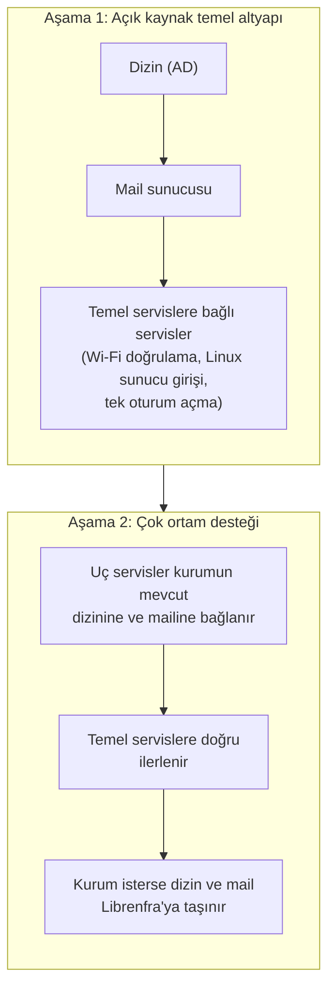
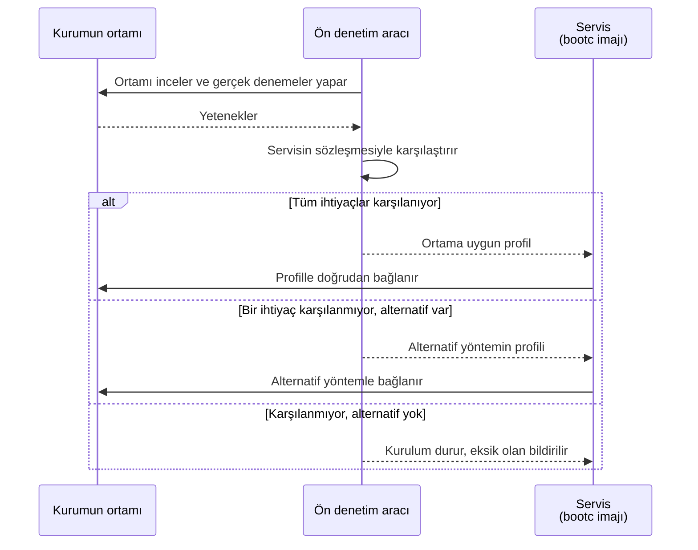

# Entegrasyon

Projenin amacı kurumların açık kaynak altyapılara geçişini kolaylaştıran bir taban sağlamak. Bu döküman, Librenfra altyapısının kurumların farklı ortamlarıyla nasıl uyumlu hale getirileceğini ve bunun geliştirme sırasındaki yerini anlatır.

Entegrasyon üzerine yapılan çalışmalar ve testler sonunda proje iki aşamaya ayrıldı ([0002](decisions/0002-iki-asamali-gelistirme.md)):

1. **Açık kaynak temel altyapı:** Bir kurumun altyapısı yalnızca açık kaynak bileşenlerle, dizin (AD) ve mail sunucularından başlanarak oluşturulur. Bu aşamada kurumların mevcut altyapısıyla uyumluluk hedeflenmez.
2. **Çok ortam desteği:** Oluşturulan altyapı, kurumlar arasındaki farklara uygun çalışabilecek hale getirilir. Destek uç servislerden başlayıp temel servislere doğru ilerler.

Entegrasyon, ikinci aşamanın konusudur. Ancak ikinci aşamanın kolay olması, birinci aşamada verilen kararlara bağlıdır. Bu yüzden döküman iki soruya cevap verir: birinci aşamada entegrasyon için neye dikkat edilmeli ve ikinci aşamada entegrasyon nasıl yapılacak?

## İki aşamanın sırası



Birinci aşamada altyapı temelden uca doğru kurulur, çünkü uç servisler temel servislere bağlıdır. İkinci aşamada sıra tersine döner: kurumlar mevcut dizin ve mail sunucularını bir anda bırakmaz. Önce uç servisleri Librenfra'dan alır, bu servisler kurumun mevcut altyapısıyla çalışır. Temel servislere en son gelinir.

## Aşama 1'de entegrasyon için dikkat edilecekler

Birinci aşamada uyumluluk hedeflenmez, ama alınan kararlar ikinci aşamanın ne kadar zor olacağını belirler.

### Standart protokoller

Servisler birbirine yalnızca standart protokollerle bağlanmalıdır: LDAP, Kerberos, RADIUS, OIDC/SAML, SMTP ve IMAP. Bir servis başka bir Librenfra servisine özel bir yolla bağlanırsa, ikinci aşamada o servisin yerine kurumun kendi sunucusu konamaz.

### Dizin bileşeni

Dizin seçimi ikinci aşamayı en çok etkileyen karardır. Kurumların büyük çoğunluğu Active Directory kullanır. Samba AD, Active Directory ile aynı protokolleri (LDAP, Kerberos, NTLM) konuşur. Birinci aşamada dizin olarak Samba AD seçilirse, servislerin bu dizine karşı yazılan ve test edilen ayarları ikinci aşamada büyük ölçüde gerçek bir Active Directory'de de çalışır. OpenLDAP ya da FreeIPA seçilirse bu köprü kurulmaz. Bu karar [0002](decisions/0002-iki-asamali-gelistirme.md) kaydında açık soru olarak duruyor.

### Servis başına dizin profili

Her servisin dizine ve mail sunucusuna nasıl bağlandığı, servisin geri kalanından ayrı bir **profil** olarak tutulmalıdır. Profil, servisin dizinle ilgili bütün ayarlarını içerir: bağlantı adresi, sorgular, grup çözümü, hesap durumu denetimi ve önbellek süreleri. İkinci aşamada yeni bir ortam desteklemek, servisin kendisini değil yalnızca profilini değiştirmek anlamına gelir.

### Servis sözleşmesi

Her servis dizinden neye ihtiyaç duyduğunu bir sözleşme dosyasında yetenekler halinde bildirir. Bir yetenek karşılanamazsa ne yapılacağı da sözleşmede yazar. Birinci aşamada bütün yetenekler Librenfra'nın kendi dizini tarafından karşılanır, ama sözleşmenin baştan yazılması ikinci aşamada hangi ortamda neyin eksik kalacağını görmeyi sağlar.

```yaml
# /usr/share/librenfra/services/wifi-dogrulama.yaml
service: wifi-dogrulama
version: 1.0.0

requires:
  - capability: password.mschapv2      # PEAP-MSCHAPv2 ile parola doğrulama
    fallback: certificate.eap-tls      # yoksa sertifikayla giriş
  - capability: domain.member          # MSCHAPv2 için domain üyeliği
  - capability: user.groups            # VLAN ataması için
    nested: true
  - capability: user.account_state     # devre dışı, süresi dolmuş, kilitli hesapları reddetmek için
    fallback: none                     # alternatifi yok, karşılanmazsa kurulum durur
```

### Güvenli varsayılanlar

Testlerde hazır araçların varsayılan ayarlarının hata vermeden yanlış ya da güvensiz sonuç verdiği görüldü. Birinci aşamada bütün parçaları Librenfra kurduğu için bu ayarlar baştan doğru seçilmelidir:

- Hesap durumu yalnızca `userAccountControl` bitine bakılarak değil; hesap süresi (`accountExpires`), kilit ve parola durumu da denetlenerek belirlenir.
- İç içe gruplar her serviste çözülür.
- Önbellek süreleri kısa tutulur. Böylece kapatılan bir hesabın erişimi SSH anahtarında, refresh token'da ve önbellekli doğrulamada da hızla kesilir.
- Mail tarafında servisler yalnızca kendi adreslerinden gönderebilir; bu denetim zarf göndericisinin yanında başlıktaki `From:` için de yapılır.

### Testler

Her servis, gerçek bir dizine karşı çalışan otomatik testlerle gelir. Bu testler birinci aşamada altyapının doğruluğunu sınar. İkinci aşamada ise aynı testler başka bir ortama karşı çalıştırılarak o ortamın desteklenip desteklenmediği gösterilir.

## Aşama 2'de entegrasyon nasıl yapılacak

### Testlerden öğrenilenler

Entegrasyon, ilk olarak servisler ile kurumun mevcut altyapısı arasında duran ve aradaki farkları çözen bir **ara katman** olarak tasarlanmıştı. Bu tasarım, Samba AD'ye karşı altı deneyle sınandı: Wi-Fi doğrulama, Linux sunucu girişi, tarayıcıda giriş, posta, çekirdek prototipi ve ortak LDAP arayüzü. Sonuçlar ikinci aşamanın nasıl yapılacağını değiştirdi:

| Bulgu | Sonuç |
| --- | --- |
| FreeRADIUS, SSSD, Keycloak ve Postfix AD'ye doğrudan, ara katman olmadan bağlanabiliyor | Ayrı bir ara katman yazılımı gerekmiyor |
| Servisleri ortak bir LDAP arayüzünün arkasına almak işi azaltmadı | Arayüz tek hata noktası ve gecikme ekledi; Kerberos, MSCHAPv2 ve parola değiştirme arayüzden geçemedi |
| Wi-Fi doğrulaması için domain üyeliği şart | Dizine yalnızca "soran" bir servis sanılan servis aslında dizine katılıyor |
| Samba AD'de MSCHAPv2 varsayılan olarak kapalı ve bu LDAP üzerinden keşfedilemiyor | Kurumun dizinini dışarıdan doğru tanımak için gerçek denemeler gerekiyor |
| Araçların varsayılan ayarları sessizce yanlış ya da güvensiz sonuç veriyor | Asıl değer, sınanmış ve güvenli varsayılanları olan ayarlarda |

### Yaklaşım

Bu bulgulara göre ikinci aşamada entegrasyon, servislerin önünde çalışan bir yazılım değil, üç parçadan oluşan bir araç takımıdır:

1. **Ortam profilleri:** Her servis için, desteklenen her ortama göre hazırlanmış ve sınanmış dizin profilleri. Örneğin Wi-Fi doğrulama servisinin Samba AD, Windows AD ve Entra ID için ayrı profilleri olur.
2. **Ön denetim aracı:** Kurulumdan önce kurumun ortamını inceler, servisin sözleşmesini bu ortamla karşılaştırır ve servisin çalışıp çalışmayacağını, çalışmayacaksa nedenini söyler. Testlerde yazılan prototip, varsayılan ayarlı bir Samba AD için Wi-Fi sözleşmesinden "MSCHAPv2 yok, alternatife geç" kararını doğru üretti.
3. **Ortam testleri:** Birinci aşamanın testleri, kurumun ortamına benzeyen test ortamlarına karşı çalıştırılır.



Ön denetim aracı yalnızca kurulumdan önce çalışır, servisin isteklerinin arasına girmez. Kurulumdan sonra servis kurumun ortamına profiliyle doğrudan bağlanır. Böylece ortak bir ara katmanın tek hata noktası ve gecikme riski ortadan kalkar.

### Uç servislerden temele

İkinci aşamada ortam desteği uç servislerden başlar. Uç servisler kurumun mevcut altyapısına yalnızca istemci olarak bağlanır; bu yüzden kurumun altyapısında değişiklik gerektirmeden kurulabilir. Temel servislere yaklaştıkça entegrasyon zorlaşır:

| Servis | Kurumun ortamından ne istiyor | Zorluk |
| --- | --- | --- |
| Tek oturum açma (OIDC/SAML) | Kullanıcı doğrulama ve gruplar | Düşük |
| Linux sunucu girişi (SSH, sudo) | Kullanıcı, grup, kimlik numarası; domain'e katılma | Düşük |
| Mail ağ geçidi | Alıcı adresinin var olup olmadığı | Düşük |
| Wi-Fi doğrulama (RADIUS) | Domain üyeliği, MSCHAPv2 için DC ayarı ya da sertifika dağıtımı | Orta |
| VPN | Doğrulama, grup bazında erişim, çok faktörlü doğrulama | Orta |
| Dosya sunucusu | Domain'e katılma, Kerberos, Windows dosya izinleri | Yüksek |
| DNS ve DHCP | Dizin adına DNS kaydı yazma yetkisi | Yüksek |
| Dizin ve mail sunucusunun yerini almak | Kurumun verisinin ve istemcilerinin taşınması | Çok yüksek |

Hangi ortamların destekleneceği ikinci aşamanın başında belirlenir. Testler, kurum içi Active Directory'nin uç servisler için en kolay başlangıç olduğunu; LDAP, Kerberos ve NTLM sunmayan yalnızca Entra ID düzeninin ise ayrı bir çalışma gerektirdiğini gösterdi.

## Riskler

- **Birinci aşamanın ikinci aşamayı kapatması:** Birinci aşamada standart dışı bir bağlantı yolu ya da AD ile uyumsuz bir dizin seçilirse, ikinci aşamada o kısım yeniden yazılmak zorunda kalır.
- **Test ortamlarının gerçeği yansıtmaması:** Samba AD üzerinde geçen bir test, gerçek Windows AD'nin bütün davranışlarını sınamaz. İkinci aşamada gerçek Windows AD, Entra ID ve Exchange test ortamları gerekir.
- **Ön denetimin yanılması:** Bir ortamın yeteneklerini yanlış okumak, özellikle hesap durumunu yanlış değerlendirmek, güvenlik açığı demektir. Ön denetim LDAP'tan okuduğuna değil, mümkün olduğunca gerçek denemelere dayanmalıdır.
- **Profil sayısının büyümesi:** Her servis ve her ortam için ayrı bir profil, bakımı zorlaşan bir sayıya ulaşabilir. Desteklenen ortamlar bilinçli olarak sınırlı tutulmalıdır.

## Açık sorular

- [ ] Birinci aşamada dizin bileşeni Samba AD mi olacak?
- [ ] Servis sözleşmesindeki yetenekler nasıl adlandırılmalı ve sürümlenmeli?
- [ ] Dizin profilleri hangi biçimde tutulmalı ve servis imajlarına nasıl eklenmeli?
- [ ] İkinci aşamada ilk desteklenecek ortamlar hangileri olacak?
- [ ] Ön denetim aracı hangi dille yazılmalı?
