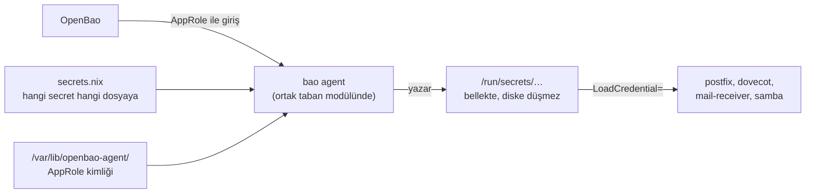

# Secret'lar

Secret'lar hiçbir repoya ve hiçbir Nix ifadesine girmez: OpenBao'da durur. Terraform çalışırken ihtiyaç duyduğu kimlikleri OpenBao'dan okur, server'lar ise kendi secret'larını OpenBao ajanıyla alır. GitHub'da tek bir kimlik bulunmaz.

## OpenBao

- **Yer:** SERVER segmentinde ayrı bir NixOS VM'i; tanımı `librenfra-secrets` reposundadır.
- **Depolama:** Integrated raft; her gece şifreli snapshot R2'deki ayrı `librenfra-backup` bucket'ına gönderilir ([State](04-state.md#bucket-düzeni)).
- **Düzen:** Tek KV v2 mount `librenfra/`, repo başına bir yol:
  - `librenfra/firewall/opnsense-api`
  - `librenfra/active-directory/administrator`: domain'i kuran Administrator parolası
  - `librenfra/active-directory/svc-mail`: Mail'in LDAP bind hesabı
  - `librenfra/active-directory/svc-openbao`: OpenBao'nun LDAP bind hesabı
  - `librenfra/active-directory/terraform`: `ad-accounts` modülünün Samba'ya bağlandığı hesap
  - `librenfra/active-directory/tls`: Samba'nın LDAPS sertifikası ve anahtarı
  - `librenfra/mail/receiver-secret`
  - `librenfra/platform/proxmox-token`
  - `librenfra/platform/cloudflare-token`
  - `librenfra/platform/r2`
  - `librenfra/platform/ssh-key`: yönetim makinesinin server'lara bağlandığı anahtar
  - `librenfra/secrets/r2-backup`: OpenBao'nun snapshot'ı yazdığı, yalnız `librenfra-backup` bucket'ına yetkili R2 anahtarı
- **Policy'ler:** `librenfra-secrets` reposunda git'te durur ([Erişim ve policy'ler](#erişim-ve-policyler)).

## Erişim ve policy'ler

Hangi kimliğin hangi secret'a erişeceği `librenfra-secrets` reposunda git'te versiyonlanır. Repo yalnız "kim hangi yola erişir" bilgisini tutar; yoldaki değer yalnız OpenBao'da durur. Policy'lerle ilgili dosyalar:

```text
librenfra-secrets/
  policies/
    admin.hcl                yöneticiler
    active-directory.hcl     Samba'nın AppRole'ü
    mail.hcl                 Mail'in AppRole'ü
    secrets.hcl              OpenBao'nun gece snapshot işi
  approles.yml               hangi server'ın AppRole'ü hangi policy'yi alır
  ldap-groups.yml            hangi Samba grubu hangi policy'yi alır
```

### Kim neye erişir

| Kimlik | Giriş | Policy | Erişim |
| --- | --- | --- | --- |
| Yönetici | LDAP, `librenfra-admins` grubu | `admin` | `librenfra/*` okur ve yazar; policy ve AppRole'leri yönetir |
| Samba | AppRole `active-directory` | `active-directory` | `active-directory/administrator`, `active-directory/tls` okur |
| Mail | AppRole `mail` | `mail` | `mail/receiver-secret`, `active-directory/svc-mail` okur |
| OpenBao | AppRole `secrets` | `secrets` | `secrets/r2-backup` okur |
| Firewall | Yok | Yok | Hiçbir şey; OPNsense'te ajan yoktur |

- **Tek kopya:** İki server aynı değere ihtiyaç duyarsa ikisinin policy'si aynı yolu okur.
- **Varsayılan red:** Policy'de yazmayan yol okunamaz. Server AppRole'leri yalnız `read` yetkisi alır; hiçbir server secret yazamaz.
- **Yalnız Terraform'un okuduğu secret'lar:** `platform/*`, `firewall/opnsense-api`, `active-directory/terraform` ve `active-directory/svc-openbao`. Bunlar yönetici oturumuyla çalışan Terraform'a gider; hiçbir server'ın policy'sinde yoktur. `svc-openbao` parolasını Terraform OpenBao'nun LDAP auth ayarına yazar.
- **Planlanan server'lar:** PostgreSQL veya Kubernetes eklenince `policies/` dizinine o server'ın dosyası, `approles.yml`'ye bir kayıt eklenir.

### Policy örneği

```hcl
# policies/mail.hcl
path "librenfra/data/mail/*" {
  capabilities = ["read"]
}

path "librenfra/data/active-directory/svc-mail" {
  capabilities = ["read"]
}
```

KV v2'de secret `librenfra/data/<yol>` altından okunur; policy'lerde bu yüzden `data/` yazılır.

### AppRole ve grup bağları

```yaml
# approles.yml
mail:
  policies: [mail]
  bound_cidrs: ["<Mail'in IP'si>/32"]
  token_ttl: 1h
active-directory:
  policies: [active-directory]
  bound_cidrs: ["<Samba'nın IP'si>/32"]
  token_ttl: 1h
secrets:
  policies: [secrets]
  bound_cidrs: ["<OpenBao'nun IP'si>/32"]
  token_ttl: 1h
```

```yaml
# ldap-groups.yml
librenfra-admins: [admin]
```

`bound_cidrs`, AppRole kimliğinin yalnız o server'ın IP'sinden kullanılabilmesini sağlar; kimlik dosyası başka bir makineye kopyalansa da çalışmaz.

### Erişim değişikliğinin yolu

1. `policies/` veya `approles.yml` değişir ve `librenfra-secrets`'a PR açılır. Diff, hangi server'ın hangi yola erişmeye başladığını ya da hangi erişimin kalktığını gösterir.
2. Merge sonrası yönetici `terraform apply` çalıştırır; `librenfra-terraform`'daki `openbao-policies` modülü policy'leri, AppRole'leri ve LDAP grup eşlemelerini OpenBao'ya yazar.
3. OpenBao'da `bao policy write` ile elle yapılan bir değişiklik bir sonraki `terraform plan`'da fark olarak görünür.

Secret değerini değiştirmek bu yoldan geçmez; değerler repoya hiç girmediği için `bao kv put` ile değiştirilir ([İnsan girişi](#insan-girişi)).

## Terraform secret'ları nasıl okur

- **Provider kimlikleri:** Yönetici `bao login` ile girer. Terraform'un vault provider'ı bu oturumla OpenBao'ya bağlanır; `librenfra-terraform`'daki `openbao-secrets` modülü Proxmox, OPNsense, Cloudflare ve Samba kimliklerini **ephemeral** kaynak olarak okur ve provider'lara verir. Ephemeral değerler state dosyasına yazılmaz.
- **Kaynak içinde gereken secret'lar:** Servis hesaplarının parolası da aynı yolla OpenBao'dan okunup Samba'ya yazılır.
- **State'e giren sırlar:** AppRole secret ID'leri gibi provider'ın state'e yazdığı değerler için bucket erişimi yalnız yönetim makinesine açıktır ([State](04-state.md)).
- **Proxmox kimliği:** `root@pam` parolası yerine yalnızca gereken yetkilere sahip bir API token (`terraform@pve!librenfra`); sızıntıda host'un root'u gitmez.

## Secret'ın server'a varış yolu



- **Server'da ajan:** OpenBao ajanı (`bao agent`) `librenfra-terraform`'daki ortak taban modülünün parçasıdır ve bir systemd servisi olarak çalışır. Server reposundaki `secrets.nix` yalnız hangi secret'ın hangi dosyaya yazılacağını tanımlayan şablonları ekler.
- **Nereye yazılır:** Ajan secret'ları `/run` altına yazar; bu dizin bellekte durur ve diske hiç düşmez. Servisler secret'ı bu dosyadan veya systemd'nin `LoadCredential=` ayarıyla okur.
- **Ajanın kimliği:** Server'ın AppRole'ü `librenfra-secrets`'taki `approles.yml`'de tanımlıdır. Server reposunun Terraform'u bu role için bir secret ID üretir; `nixos-server` modülü ilk kurulumda role ve secret ID'yi nixos-anywhere ile `/var/lib/openbao-agent/` altına koyar. Server güncellemelerinden etkilenmez.
- **Nix ifadesinde secret yok:** `/nix/store` server'daki herkes tarafından okunabilir ve build sonuçları yönetim makinesinin store'unda da durur. Bir Nix ifadesine yazılan değer bu yüzden sızmış sayılır.

## İnsan girişi

Yöneticiler `bao login -method=ldap` ile Samba hesaplarıyla girer; OpenBao'nun LDAP auth'u `svc-openbao` hesabıyla Samba'ya LDAPS üzerinden bağlanır ve `librenfra-admins` grubunu admin policy'sine eşler. Samba kurulana kadar userpass kullanılır. Secret değiştirmek PR değil `bao kv put` ile yapılır; OpenBao audit log'u kimin neyi ne zaman okuduğunu tutar.

## Unseal ve kurtarma

Shamir anahtarları (örneğin 5'te 3) birden fazla yöneticide, Proxmox dışında saklanır. Host yeniden başlayınca OpenBao elle unseal edilir; o zamana kadar Terraform çalışamaz ve server ajanları yeni secret alamaz. Çalışan servisler `/run`'daki son değerle devam eder, ama yeniden başlayan bir server unseal'a kadar secret'sız açılır.

## Bootstrap

OpenBao kendi secret'ına ihtiyaç duymadan kurulmalı. Firewall ve OpenBao, OpenBao henüz yokken kurulduğu için ilk `apply`'larında provider kimliklerini yönetim makinesindeki ortam değişkenlerinden alır. OpenBao kurulup unseal edildikten sonra platform kimlikleri (Proxmox token, Cloudflare token, R2 anahtarı, SSH anahtarı, OPNsense API anahtarı) OpenBao'ya elle girilir ve ortam değişkenleri silinir.

## Koruma

`gitleaks` hem pre-commit'te hem CI'da çalışır; `.gitignore` secret dosyalarını dışarıda tutar.
